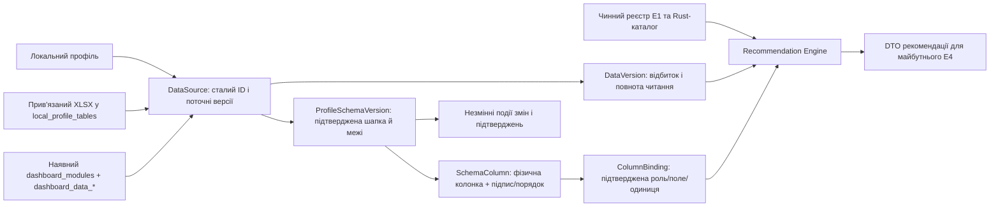

# E3-П: архітектура локального джерела та схеми профілю

**Стан:** проєкт для J5/JE, 21.10.2026. Це не реалізація E3 і не дозвіл на міграцію. База огляду: `origin/main` `3f0809bfc5ed3bcc55f78fef997464df72c3ecc4`; прийнятий Recommendation Engine: `d94765478281e58e77533fe007691cf581b01c76`. Перед реалізацією повторно перевірити `main`.

**Пакет:** [DDL-проєкт](E3_SCHEMA_PROPOSAL.sql), [API-контракт](E3_API_CONTRACT.md), [міграція й відновлення](E3_MIGRATION_ROLLBACK.md), [тестова матриця](E3_TEST_MATRIX.md), [рішення JE](E3_DECISIONS.md).

## 1. Чинні межі

| Факт у коді | Наслідок для E3 |
|---|---|
| `local_profiles.id` — локальний власник; `local_profile_tables` зберігає шлях за `(profile_id, branch)` (`0003`, `0008`) | Нове джерело належить одному профілю. Шлях залишається у Rust/SQLite, не в JS DTO. |
| `dashboard_modules` зберігає `profile_id`, `storage_table`; `dashboard_data_<id>` створюється для кожного старого модуля (`0010`, `dashboard_modules.rs`) | Старі таблиці лишаються. Нові рекомендації посилаються на одне джерело і не створюють таблиці модулів. |
| `dashboard_module_corrections` зберігає сирий текст, виправлення й координати (`0011`, `0016`) | Історичні корекції не переносити й не трактувати як прив'язки стовпців. |
| `synchronize_template_schema()` видаляє й повторно заповнює `dashboard_module_fields` при зміні шаблону | Назви, порядок і `ColumnBinding` зберігати тільки у нових таблицях E3. |
| `module_source.rs` віддає непорожні рядки з координатами, максимум 10 000 + 50 рядків і 200 колонок; `module_source_selection.rs` перевіряє SHA-256 файла, профіль, вікно, сеанс і TTL 1 година | Порожні рядки відновлюються з прогалин номерів; часткове читання не дає `ready`. Тимчасовий selection не може бути постійним ID. |
| `src/module-definition-core.js` об'єднує E1-описи Rust/v1/legacy; `dashboard-recommendation-core.js` використовує їхні ролі та повертає `previewOnly` | E3 не створює третього каталогу. У БД зберігаються лише посилання `definitionId`, `fieldKey`, `role`, версія каталогу й підтвердження. |

## 2. Сутності та залежності

`DataSource` має випадково згенерований непрозорий `ds-<hex>` ID. Назва файла, шлях, SHA-256 вмісту й номер версії не є ID. Власник — `profile_id`, отриманий з активної перевіреної сесії Rust. `linked_xlsx` посилається на поточну прив'язку `(profile_id, branch)` і пам'ятає відбиток локатора; `module_sqlite` посилається на наявний `dashboard_modules.id` того самого профілю. Перший потік обслуговує **одне джерело й одну підтверджену ділянку одного аркуша**. Схема допускає більше джерел згодом, але E3б (join/merge) тут відсутній.

`DataVersion` — послідовний номер **спостереженого** стану конкретного `DataSource`, а не ідентичність модуля. XLSX: відбиток байтів SHA-256 разом із перевіркою поточної прив'язки; SQLite: повторне читання модуля у сталому знімку й канонічний відбиток рядків/схеми. Версія зберігає історичний ключ прив'язки й відбиток локатора (без повного шляху), тому явний relink також утворює нову версію, навіть коли байти однакові. Якщо джерело недоступне або обрізане, фіксується причина й стан `unavailable`/`partial`; самі робочі рядки E3 не дублює. Такий відбиток не доводить походження файла між перейменуваннями: переприв'язування вирішує користувач.

`ProfileSchemaVersion` — незмінний знімок вибору аркуша/ділянки, окремих підтверджень шапки та меж, фізичних колонок, користувацьких підписів і порядку. Підтвердження прив'язки (`ColumnBinding`) належить конкретним `source_id`, `schema_version`, фізичній колонці, `definitionId` і `fieldKey`; альтернативні ролі не стираються пропозицією іншої ролі. Нова правка створює **наступну версію схеми** й подію; старий знімок лишається для аудиту. `needs_reconfirmation` фіксується у новому знімку або в обчисленому ефективному стані, якщо джерело змінилося після нього.

Непідтверджені альтернативи лишаються в результаті `proposeBindings()` разом із походженням (`origins`) і не перетворюються на збережені binding. Після перезапуску їх можна переобчислити з того самого E1-каталогу; підтверджену користувачем альтернативу зберігає E3, а зміна сигнатури каталогу викликає повторну перевірку. Історія підтверджень фіксує рішення, не копіює весь перелік гіпотез.

Фізичний `column_id` у першій версії — `c1`, `c2` тощо, як у прийнятому JS-рушії, але його сталість обмежена відбитком фізичної схеми та підтвердженою ділянкою. Два однакові заголовки різняться позицією. Перестановка, вставка чи видалення колонки змінює fingerprint і блокує автоматичне перенесення підтвердження. Користувацький порядок показу — окремий `display_position`, не фізичний індекс.

Ідентичність рядка XLSX у межах DataVersion: `(source_id, data_version, sheet_index, region_start, source_row_number)`. Для `module_sqlite`: `(source_id, data_version, module_id, row_id)`. Це **локатор походження версії**, а не стабільний бізнес-ключ між редагуваннями файла. Для значення додати `column_id`, сирий тип/значення з прочитаного джерела та стан розбору лише у пам'яті під час читання; нове E3-сховище не містить копій клітинок. Координати й версія передаються в результаті читання; неповний або зниклий рядок не замовчується. Існуючий `dashboard_data_*.row_id` не дорівнює номеру рядка XLSX.

## 3. Чотири шари даних

1. **Сире джерело:** прив'язаний файл XLSX або наявна таблиця SQLite; вихідний XLSX не переписується. Наявні `raw_sources`/`reports` із `0001` мають інше призначення й не отримують автоматичного імпорту E3.
2. **Розібрані значення:** еферемерний результат чинного читача та парсера з координатами й `DataVersion`. Повторне читання за збереженим `DataSource` після перезапуску; якщо файл змінився — нове спостереження, а не тихе перевикористання.
3. **Ручні виправлення:** чинні `manual_corrections` і `dashboard_module_corrections` лишаються окремими; E3 не мігрує їх і не змішує з `ColumnBinding`. Для майбутнього спільного ряду потрібна окрема політика виправлень та рішення JE.
4. **Схвалені записи:** чинні `review_decisions`/`revision_history` та старі дані модулів не перетворюються E3 автоматично. Підтвердження шапки/меж/ролі схвалює **схему**, а не бойовий запис.

Один `DataSource` може годувати дві майбутні картки: обидві посилаються на один ID/версію; E3 не створює `ModuleInstance` і не викликає старий `create_with_import()`. Для чинних модулів опційне представлення як `module_sqlite` не переміщує `dashboard_data_*` і не змінює їхню поведінку.

## 4. Версії, доступність і конфлікти

- `data_version` збільшується при новому підтвердженому спостереженні зміненого вмісту **або явній зміні локатора**. `schema_version` збільшується на кожну зміну вибору ділянки, шапки, меж, підпису, порядку або binding. Порожній повторний аналіз не створює версій.
- Фізичний fingerprint охоплює вибраний аркуш і ділянку, номер шапки, впорядковані позиції/заголовки/типи колонок; відбиток байтів XLSX окремий. Сумісне оновлення **даних** із незмінним fingerprint може використовувати підтверджену схему. Сумісне оновлення **каталогу** з тим самим `definitionId`, `fieldKey`, типом, роллю, одиницею та агрегацією зберігає binding; несумісне переводить його у `needs_reconfirmation` до рішення користувача.
- Стани: `complete` — весь обраний набір прочитано, джерело й схема збігаються; `partial` — перевищено ліміт або неповне читання; `unavailable` — шлях/аркуш/модуль відсутній чи пошкоджений; `stale` — вміст, прив'язка або фізична схема змінилися після підтвердження. Ці стани не означають, що операційні записи схвалено.
- Запис отримує `expected_data_version` і `expected_schema_version`; Rust робить умовний `UPDATE` у тій самій транзакції перед записом нового знімка. 0 змінених рядків = `VersionConflict`, без часткового стану. Невідома/новіша версія каталогу або схеми = читання метаданих без застосування binding та без запису.

## 5. Вхідний сценарій та межа E4

`inspect_linked_module_source` / `pick_module_source` → `read_module_source_sheet` → `profileSource()` у preview → окреме підтвердження шапки й меж → `proposeBindings()` → явні рішення для ролі/одиниці/агрегації → Rust CAS-запис `DataSource`/версій/`ColumnBinding` → повторне читання з `sourceId` і `sourceVersion` → `recommend()`.

Preview `sourceKey`/`previewId`/selection token не зберігаються як постійний ключ. Після запису Rust повертає сталий `sourceId`, версію, ділянку й поточний fingerprint; JS знову профілює ті самі прочитані рядки з цими значеннями. Рекомендаційний ID лишається версійним і не є майбутнім `ModuleInstance.id`. При перезапуску Rust відновлює прив'язку, перевіряє файл/таблицю та версію, віддає підтвердження в E1-контракт; якщо fingerprint/повнота не збігаються, `recommend()` не отримує їх як чинні. DTO до E4 містить `sourceId`, `dataVersion`, `schemaVersion`, `definitionId`, `bindingRefs`, `readiness`, `warnings`, `variantsIncomplete`, `previewOnly`; він нічого не створює.

## 6. Майбутні файли та малі задачі (лише після рішення JE)

| Крок | Майбутні файли | Відокремлена перевірка |
|---|---|---|
| E3.1 | `src-tauri/migrations/0017_data_source_profile_schema.sql`, `src-tauri/src/database.rs`, `docs/DATABASE.md`, `src-tauri/migrations/README.md` | Міграція старої синтетичної БД, FK, backup/restore, невідома схема. |
| E3.2 | `src-tauri/src/data_sources.rs` | Профільна ізоляція, версії, CAS, перезапуск, нуль копій рядків. |
| E3.3 | `src-tauri/src/data_source_adapter.rs`, вузький виклик у `src-tauri/src/lib.rs` | Стабільне локальне читання XLSX/SQLite, ліміти, зміна файла, без нових capabilities. |
| E3.4 | `src/dashboard-recommendation-core.js` (лише адаптер підтверджень), `src/dashboard-data-source.js`, `tests/dashboard-recommendation.test.mjs` | Preview → сталий source, збереження неоднозначностей, відсутність `ready` при partial/stale. |
| E3.5 | Окремий UI потоку підтверджень і його тести, `docs/USER_GUIDE.md` | Перезапуск/оновлення каталогу з синтетичними даними; старий дашборд без регресії. |

Кроки E3.1–E3.5 не починати за цим документом. E3б, E3в та E4 мають окремі рішення й задачі.

## 7. Точкові джерела для рецензії

- [Дорожня карта E3](../../MODULES_ROADMAP.md#5-етапи) та її правило схеми профілю.
- [E1 реєстр і ролі](../../../src/module-definition-core.js#L39), [композиція визначень](../../../src/module-definition-core.js#L371).
- [Preview/підтвердження рушія](../../../src/dashboard-recommendation-core.js#L128), [binding proposals](../../../src/dashboard-recommendation-core.js#L234), [readiness](../../../src/dashboard-recommendation-core.js#L432).
- [Ліміти читача XLSX](../../../src-tauri/src/module_source.rs#L22), [selection TTL та SHA-256](../../../src-tauri/src/module_source_selection.rs#L18).
- [Синхронізація полів Rust](../../../src-tauri/src/dashboard_modules.rs#L1659), [startup-кандидат і backup](../../../src-tauri/src/migration_startup.rs#L46).
